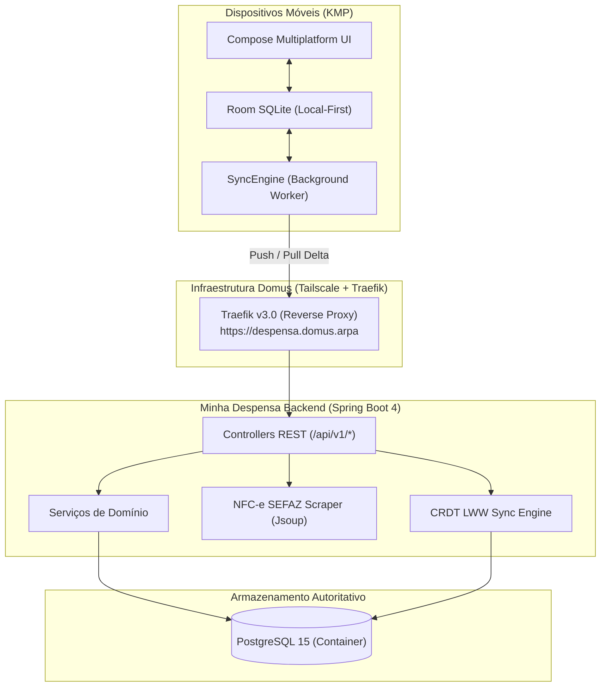
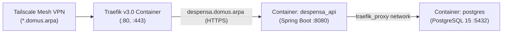
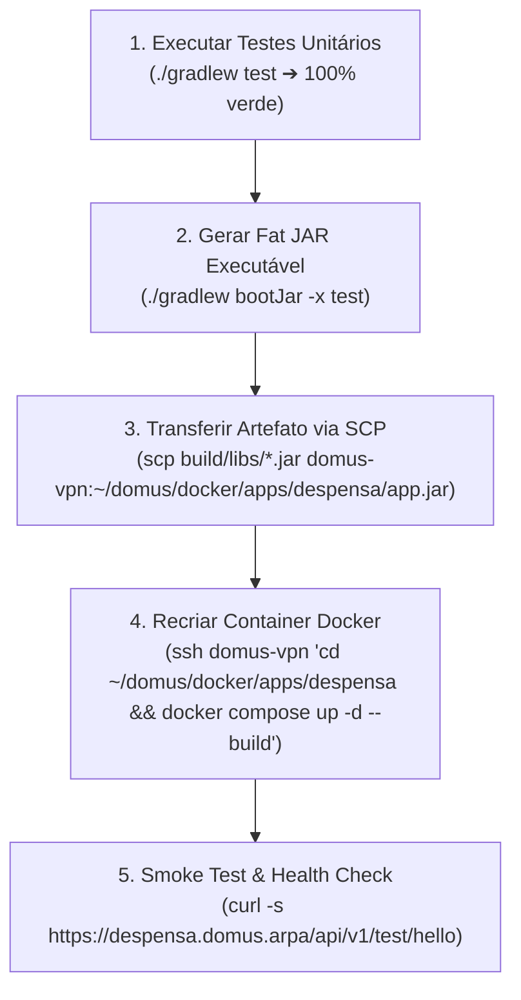

# Minha Despensa Backend — Arquitetura, Domínios & Operação

> **Versão:** 1.0.0  
> **Última Atualização:** 18/10/2026  
> **Ambiente de Produção:** Domus Home Server (`https://despensa.domus.arpa`)  
> **Repositório:** `Minha-Despensa-Backend`  
> **Cliente Integrado:** [Minha-Dispensa (Compose Multiplatform / Room)](../Minha-Dispensa)

---

## 1. 🎯 Identidade & Papel Arquitetural do Servidor

O **Minha Despensa Backend** é o servidor dedicado, hub central de dados e orquestrador de serviços do ecossistema **Minha Despensa**. Ele foi concebido para atuar em sinergia estrita com o paradigma **Local-First / Offline-First** do aplicativo cliente móvel (Android & iOS via Compose Multiplatform):



### Princípios Norteadores
1. **Local-First Enabler:** O cliente móvel nunca é bloqueado por latência de rede. O backend fornece endpoints otimizados para sincronismo em lote (*bulk sync*) com deltas baseados em timestamps UTC.
2. **Modular Monolith:** A estrutura do projeto é segmentada por domínios de negócio verticais com alto acoplamento interno e baixo acoplamento entre módulos.
3. **Consistência Eventual via LWW (Last-Write-Wins):** Resolução de conflitos determinística baseada no carimbo de data/hora mais recente de modificação.
4. **Higiene de Dados & Soft Delete:** Entidades sincronizáveis nunca sofrem deleção física instantânea; registros marcados com `isDeleted = true` propagam o evento de exclusão para todos os dispositivos pareados.

---

## 2. 🏛️ Estrutura de Pacotes & Módulos Verticais

```text
com.bitlabbr.minhadespensa
├── common/                  # Infraestrutura transversal e utilitários
│   ├── config/              # OpenApiConfig (Swagger UI) e WebConfig (CORS)
│   ├── dto/                 # ApiResponse<T> e ErrorResponse padronizados
│   ├── entity/              # BaseSyncEntity (id, updatedAt, isDeleted)
│   └── exception/           # Hierarquia de exceções de domínio e GlobalExceptionHandler
├── controller/              # Endpoints de diagnóstico (TestController)
└── modules/                 # Módulos verticais de negócio
    ├── catalog/             # Catálogo mestre de produtos (Entity, DTOs, Repository, Service, Controller)
    ├── pantry/              # Estoque doméstico, agregação e controle de validade
    ├── shoppinglist/        # Listas de compras (PLANNED, SCRATCHPAD) com soft-delete em cascata
    ├── price/               # Histórico de preços por produto e estabelecimento
    ├── sync/                # Motor de replicação bidirecional CRDT LWW
    └── invoice/             # Leitura e parsing de Nota Fiscal SEFAZ-PE via QR Code
```

### Responsabilidades por Módulo

| Módulo | Escopo & Responsabilidade | Entidades Principais |
| :--- | :--- | :--- |
| **`catalog`** | Gestão do catálogo mestre de produtos mercado (EAN, nome, categoria, marca, unidade de medida). Não possui estado de estoque. | `ProductEntity` |
| **`pantry`** | Gestão das instâncias físicas de produtos na despensa da casa, organizadas por lotes de compra, validade e controle de consumo. | `PantryItemEntity` |
| **`shoppinglist`**| Listas de compras dinâmicas ou planejadas, itens pendentes/adquiridos, com regras de cascade soft-delete em itens órfãos. | `ShoppingListEntity`, `ShoppingItemEntity` |
| **`price`** | Histórico financeiro de preços pagos por unidade, data e local de compra para alimentar comparativos de mercado. | `PriceEntryEntity` |
| **`sync`** | Motor de reconciliação em lote: recebe push de alterações locais e fornece deltas incrementais no pull com `serverTimestamp`. | N/A (orquestra os repositórios dos domínios) |
| **`invoice`** | Scraping e parsing de notas fiscais eletrônicas de consumidor (NFC-e SEFAZ PE) para auto-preenchimento do app. | DTOs de extração |

---

## 3. 🌐 Topologia de Infraestrutura & Servidor (Domus)

A aplicação é implantada no servidor doméstico dedicado `domus` via Docker e protegida por rede privada Tailscale e proxy reverso Traefik com TLS automatizado:



### Detalhes Técnicos do Ambiente
- **Host SSH:** `domus-vpn` (`100.98.199.97`, usuário `willjsan`)
- **DNS / Domínio:** `https://despensa.domus.arpa`
- **Proxy Reverso:** Traefik v3.0 com configuração dinâmica em `~/domus/docker/misc/certs.yaml`:
  - Roteador: `despensa-router` escutando em `websecure` (HTTPS :443)
  - Serviço: `http://despensa_api:8080`
  - Redirecionamento automático de HTTP (:80) para HTTPS (:443)
  - Certificado Wildcard TLS: `/etc/traefik/certs/_wildcard.domus.arpa+3.pem`
- **Banco de Dados:** PostgreSQL 15 rodando no container `postgres` na rede `traefik_proxy`:
  - JDBC URL: `jdbc:postgresql://postgres:5432/despensa`
  - Usuário: `despensa_user`
- **Container da Aplicação:** `despensa_api`:
  - Imagem base: `eclipse-temurin:17-jre`
  - Diretório de deploy: `/home/willjsan/domus/docker/apps/despensa/`
  - Limite de memória: `512m`
  - Restart policy: `unless-stopped`

---

## 4. 📐 Diretrizes de Arquitetura & Padrões de Código

### 4.1. BaseSyncEntity & Last-Write-Wins (LWW)
Todas as entidades sincronizáveis herdam obrigatoriamente de `BaseSyncEntity`:
```kotlin
@MappedSuperclass
abstract class BaseSyncEntity(
    @Id
    @Column(nullable = false, length = 36)
    open var id: String = UUID.randomUUID().toString(),

    @Column(nullable = false)
    open var updatedAt: Long = System.currentTimeMillis(),

    @Column(nullable = false)
    open var isDeleted: Boolean = false
)
```
**Regras de Persistência no Service:**
- **Atualização LWW:** Ao receber um payload com `updatedAt`, comparar com a entidade do banco. Se `payload.updatedAt < existing.updatedAt`, a alteração recebida é descartada (o estado do servidor é mais recente).
- **Soft Delete:** Nunca realizar `repository.delete()`. Alterar `isDeleted = true`, atualizar `updatedAt = max(payload.updatedAt, System.currentTimeMillis())` e salvar.

### 4.2. Desserialização Jackson 3 em Kotlin Data Classes
Spring Boot 4.x utiliza Jackson 3 (`tools.jackson`). Em Kotlin data classes com construtor primário:
- **NUNCA usar o target `@field:` em `@JsonAlias` ou `@JsonProperty`**:
  ```kotlin
  // ❌ INCORRETO (o deserializador creator de construtor do Jackson ignora aliases no field):
  @field:JsonAlias("codigoBarras") val ean: String? = null

  // ✅ CORRETO (anota o parâmetro/propriedade do construtor primário):
  @JsonAlias("codigoBarras") val ean: String? = null
  ```

### 4.3. Tratamento Centralizado de Exceções
Todas as exceções são capturadas pelo [`GlobalExceptionHandler`](file:///Users/willian/Projetos/Minha-Despensa-Backend/Minha-Despensa-Backend/src/main/kotlin/com/bitlabbr/minhadespensa/common/exception/GlobalExceptionHandler.kt):
- `ResourceNotFoundException` ➔ `404 Not Found` (logado em `WARN`)
- `ConflictException` ➔ `409 Conflict` (logado em `WARN`)
- `InvalidRequestException` ou `IllegalArgumentException` ➔ `400 Bad Request` (logado em `WARN`)
- `BusinessException` ➔ `422 Unprocessable Entity` (logado em `WARN`)
- `MethodArgumentNotValidException` ➔ `400 Bad Request` com array `fieldErrors` (logado em `WARN`)
- `Exception` genérica ➔ `500 Internal Server Error` (logado em `ERROR` com stack trace)

### 4.4. Observabilidade & Estratégia de Logs
O backend possui um pipeline unificado de logs para auditoria de tráfego móvel e solução rápida de problemas:
- **`RequestLoggingFilter`:** Filtro servlet de alta prioridade que audita todas as requisições sob `/api/**`:
  `[HTTP] {MÉTODO} {URI}{QUERY} - Status: {STATUS} ({DURAÇÃO}ms) - Client: {IP_TAILSCALE}`
- **Formatação Estruturada:** Console configurado com timestamp UTC/ISO, thread, destaque de cores e logger da classe em `application.properties`.
- **Inspeção Remota:** Durante o deploy e testes, os logs do container `despensa_api` devem ser inspecionados para validar o ciclo de vida e a chegada das requisições móveis:
  ```bash
  ssh domus-vpn "docker logs -f --tail 30 despensa_api"
  ```

---

## 5. 🚢 Runbook Oficial de Build & Deploy

O fluxo de implantação no servidor `domus` segue um roteiro estrito de 5 etapas automatizadas:



### Comandos de Terminal

```bash
# Passo 1: Garantir que 100% dos testes passam localmente
./gradlew test

# Passo 2: Empacotar a aplicação Spring Boot
./gradlew bootJar -x test

# Passo 3: Enviar o JAR para o host remoto Domus
scp build/libs/Minha-Despensa-Backend-0.0.1-SNAPSHOT.jar domus-vpn:~/domus/docker/apps/despensa/app.jar

# Passo 4: Recompilar a imagem Docker e reiniciar o container
ssh domus-vpn "cd /home/willjsan/domus/docker/apps/despensa && docker compose up -d --build"

# Passo 5: Validar a saúde do serviço via HTTPS e Traefik
curl -s https://despensa.domus.arpa/api/v1/test/hello
```

---

## 6. 🧪 Política de Testes Automatizados

O backend adota a política de **100% de Testes Verdes Obrigatórios**:
- Toda regra de negócio (Services) possui teste unitário com mocks via `mockito-kotlin`.
- Todo endpoint (Controllers) possui teste de contrato WebMvc com `MockMvc` validando códigos HTTP (200, 201, 400, 404, 409) e envelopes JSON.
- Nenhuma alteração é implantada em produção se houver falhas na suíte de testes.
