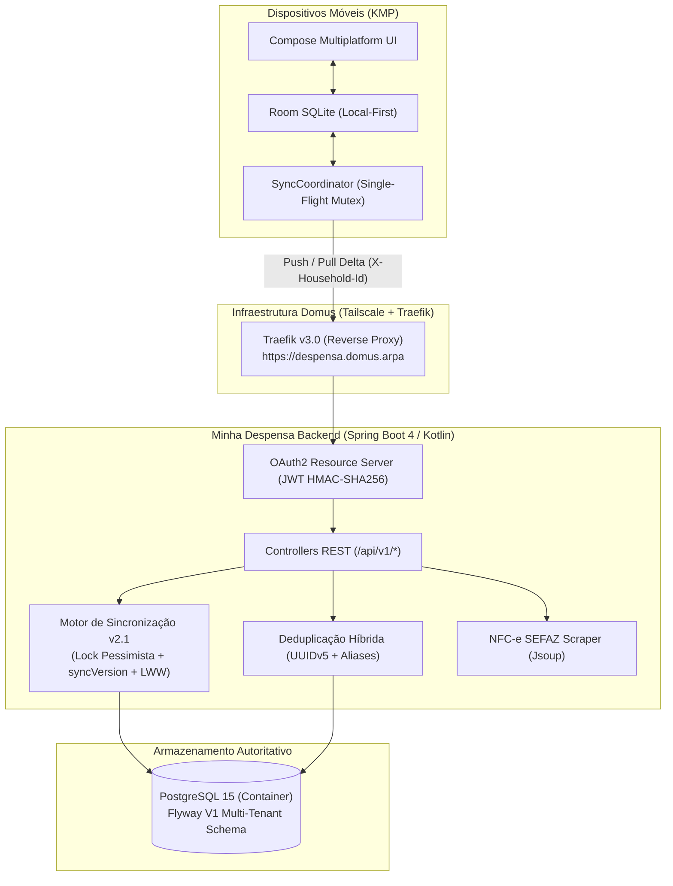
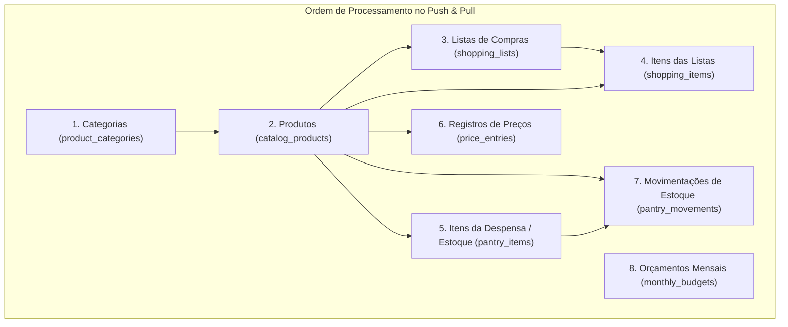
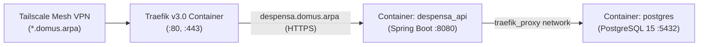

# Minha Despensa Backend — Arquitetura, Domínios & Operação

> **Versão:** 2.2.0  
> **Última Atualização:** 23/10/2026  
> **Ambiente de Produção:** Domus Home Server (`https://despensa.domus.arpa`)  
> **Repositório:** `Minha-Despensa-Backend`  
> **Cliente Integrado:** [Minha-Dispensa (Compose Multiplatform / Room)](../Minha-Dispensa)

---

## 1. 🎯 Identidade & Papel Arquitetural do Servidor

O **Minha Despensa Backend** é o servidor dedicado, hub central de sincronização multi-tenant e orquestrador de serviços do ecossistema **Minha Despensa**. Ele atua em sinergia estrita com o paradigma **Local-First / Offline-First** do aplicativo cliente móvel (Android & iOS via Compose Multiplatform):



### Princípios Norteadores
1. **Multi-Tenant Scoped by Household:** Nenhum dado vaza entre casas. Toda entidade de negócio syncable herda de `HouseholdScopedSyncEntity` com chave primária composta `(household_id, id)`.
2. **Local-First Enabler:** O cliente móvel nunca é bloqueado por latência de rede. O backend fornece sincronização bidirecional em lote (*bulk sync*) em ordem topológica estrita com deltas paginados por `serverVersion`.
3. **Serialização Monotônica (`syncVersion`):** Evita condições de corrida em `updatedAt`. Cada Push adquire um lock pessimista na linha da casa (`households`), incrementa o `syncVersion` monotonicamente e carimba todos os registros do lote com a versão gerada.
4. **Deduplicação Híbrida & Aliases Duráveis (`entity_id_aliases`):** Produtos cadastrados offline em dispositivos diferentes com o mesmo EAN ou mesmo par `(normalizedName, measureUnit)` convergem automaticamente para o registro canônico mais antigo. O backend registra o remapeamento na tabela durável `entity_id_aliases` e retorna `productIdMappings` para que o cliente ajuste suas chaves estrangeiras locais.
5. **Cascade Tombstones ("Tombstone do pai vence o filho"):** Ao excluir uma lista de compras (`isDeleted = true`), todos os seus itens tornam-se automaticamente excluídos no servidor. Itens sincronizados cujas listas pai já faleceram são forçados para `isDeleted = true`.
6. **Autenticação Segura JWT com Rotação de Refresh Token:** Tokens de acesso HMAC-SHA256 de curta duração (1h) e tokens de atualização persistidos apenas em forma de hash SHA-256 com detecção de reuso e revogação de família.
7. **Códigos de Convite Amigáveis (Crockford Base32):** Ingressar em uma despensa compartilhada utiliza códigos no formato `CASA-XXXXXXXX` gerados a partir do alfabeto Base32 de Crockford (`ABCDEFGHJKLMNPQRSTUVWXYZ23456789`), excluindo caracteres ambíguos (`0/O/1/I`) e insensíveis a maiúsculas/minúsculas.

---

## 2. 🏛️ Estrutura de Pacotes & Módulos Verticais

```text
com.bitlabbr.minhadespensa
├── common/                  # Infraestrutura transversal e utilitários
│   ├── config/              # OpenApiConfig (Swagger UI) e WebConfig (CORS)
│   ├── dto/                 # ApiResponse<T> e ErrorResponse padronizados
│   ├── entity/              # HouseholdEntityId e HouseholdScopedSyncEntity
│   ├── exception/           # Hierarquia de exceções e GlobalExceptionHandler
│   └── util/                # DeterministicIdUtils (Normalizador e RFC 4122 UUIDv5)
├── controller/              # Endpoints de diagnóstico (TestController)
└── modules/                 # Módulos verticais de negócio
    ├── auth/                # Autenticação JWT, Registro, Rotação e Revogação
    ├── household/           # Gestão de Casas, Convites Crockford e Controle de Membros
    ├── catalog/             # Catálogo de Produtos, Categorias e Mídia (Fotos WebP)
    ├── pantry/              # Itens de Despensa (Estoque) e Movimentações (Livro-Razão)
    ├── shoppinglist/        # Listas e Itens de Compras com Cascade Tombstone
    ├── price/               # Histórico de Preços por Estabelecimento
    ├── budget/              # Orçamentos Mensais
    ├── sync/                # Motor de Sincronização Bidirecional v2.1 e Aliases
    ├── invoice/             # Leitura e parsing de Nota Fiscal SEFAZ-PE via QR Code
    └── apprelease/          # Distribuição OTA de APKs Android e Metadados de Versão
```

---

## 3. 📋 Matriz de Endpoints da API REST (v1)

### 3.1. Autenticação (`/api/v1/auth`)
| Método | Endpoint | Autenticação | Descrição |
| :--- | :--- | :--- | :--- |
| `POST` | `/api/v1/auth/register` | Aberto | Cria usuário, senha com hash BCrypt, casa pessoal inicial e inicializa 9 categorias padrão |
| `POST` | `/api/v1/auth/login` | Aberto | Autentica e emite par de tokens (Access JWT + Refresh Token) |
| `POST` | `/api/v1/auth/refresh` | Aberto | Rotação de refresh token com detecção de reuso |
| `POST` | `/api/v1/auth/logout` | Requer Bearer Auth | Revoga o refresh token ativo do dispositivo |
| `GET` | `/api/v1/auth/me` | Requer Bearer Auth | Retorna o perfil do usuário autenticado |

### 3.2. Casas Compartilhadas (`/api/v1/households`) — Requer Bearer Auth
| Método | Endpoint | Descrição |
| :--- | :--- | :--- |
| `GET` | `/api/v1/households` | Lista todas as casas em que o usuário autenticado é membro |
| `GET` | `/api/v1/households/{id}` | Retorna os detalhes e integrantes de uma casa específica |
| `POST` | `/api/v1/households` | Cria uma nova casa, define o usuário como `OWNER` e inicializa 9 categorias padrão |
| `PUT` | `/api/v1/households/{id}` | Renomeia uma casa (requer privilégio de membro) |
| `POST` | `/api/v1/households/join` | Ingressa em uma casa via código de convite `CASA-XXXXXXXX` |
| `POST`, `DELETE` | `/api/v1/households/{id}/leave` | Sai de uma casa compartilhada |
| `POST` | `/api/v1/households/{id}/invite-code/regenerate`, `/{id}/regenerate-invite-code` | Regenera o código de convite (apenas `OWNER`) |
| `DELETE` | `/api/v1/households/{id}/members/{userId}` | Remove um membro da casa (apenas `OWNER`) |

### 3.3. Sincronização Bidirecional v2.1 (`/api/v1/sync`) — Requer Bearer Auth + `X-Household-Id`
| Método | Endpoint | Descrição |
| :--- | :--- | :--- |
| `POST` | `/api/v1/sync/push` | Envia lote das 8 coleções, incrementa `syncVersion` e resolve aliases |
| `GET` | `/api/v1/sync/pull` | Baixa deltas de todas as 8 entidades com `serverVersion > sinceVersion` |

### 3.4. Mídia de Produtos (`/api/v1/media/products`) — Requer Bearer Auth + `X-Household-Id`
| Método | Endpoint | Descrição |
| :--- | :--- | :--- |
| `PUT` | `/api/v1/media/products/{productId}` | Upload de foto (WebP/JPEG até 200KB) com hash SHA-256 |
| `GET` | `/api/v1/media/products/{productId}` | Download de foto com suporte a ETag / 304 Not Modified |
| `DELETE` | `/api/v1/media/products/{productId}` | Exclui foto do produto na casa e incrementa syncVersion |

### 3.5. Distribuição de Atualizações do Aplicativo (`/api/v1/app`) — Aberto
| Método | Endpoint | Descrição |
| :--- | :--- | :--- |
| `GET` | `/api/v1/app/version/latest` | Consulta metadados e changelog da versão mais recente (OTA) |
| `GET` | `/api/v1/app/download/latest` | Download em stream binário do APK da versão mais recente |
| `GET` | `/api/v1/app/download/{versionName}` | Download em stream binário do APK de versão histórica específica |

### 3.6. Nota Fiscal SEFAZ (`/api/v1/invoice`) & Testes
| Método | Endpoint | Descrição |
| :--- | :--- | :--- |
| `POST` | `/api/v1/invoice/parse` | Scraping de nota fiscal eletrônica via QR Code SEFAZ |
| `GET` | `/api/v1/test/hello` | Health check básico de conectividade |

### 3.7. Suporte, Diagnóstico, Relato de Bugs & Painel Web (`/api/v1/support` & `/support`)
| Método | Endpoint | Descrição |
| :--- | :--- | :--- |
| `GET` | `/support` | Painel Web SPA de Suporte e Diagnósticos (HTML5/Dark Glassmorphism) com login administrativo, KPIs em tempo real, filtros, terminal de logs e download de arquivos |
| `POST` | `/api/v1/support/auth/login` | Autenticação exclusiva de administrador do sistema (`SUPPORT_ADMIN_USERNAME` / `SUPPORT_ADMIN_PASSWORD`), emitindo JWT com perfil `SYSTEM_ADMIN` (aberto/permitAll) |
| `POST` | `/api/v1/support/bug-reports` | Registra chamado de suporte/bug/crash com anexo multipart opcional (`device.log`), gerando protocolo `BUG-YYYYMMDD-XXXX` (aberto/permitAll) |
| `GET` | `/api/v1/support/bug-reports` | Lista relatos de suporte com filtros opcionais por `status` e `category` (requer perfil `SYSTEM_ADMIN`) |
| `GET` | `/api/v1/support/bug-reports/{protocol}` | Consulta detalhes unitários completos de um chamado pelo protocolo (requer perfil `SYSTEM_ADMIN`) |
| `PATCH` | `/api/v1/support/bug-reports/{protocol}/status` | Atualiza status de triagem do chamado (`OPEN`, `INVESTIGATING`, `RESOLVED`, `CLOSED`) (requer perfil `SYSTEM_ADMIN`) |
| `GET` | `/api/v1/support/bug-reports/{protocol}/log` | Download em stream de texto bruto do `device.log` anexado ao chamado (requer perfil `SYSTEM_ADMIN`) |

---

## 4. 🔄 Topologia do Motor de Sincronização Bidirecional v2.1

A sincronização entre o aplicativo KMP e o servidor processa rigorosamente a ordem topológica das 8 coleções para garantir integridade referencial:



### 4.1. Algoritmo de Deduplicação Híbrida de Produtos & Categorias
Quando um dispositivo envia um produto no Push:
1. O backend busca por chave primária `(household_id, targetId)`.
2. Se `ean != null`: busca por chave natural `findByHouseholdIdAndEan(householdId, cleanEan)`.
3. Se `ean == null`: busca por chave natural `findByHouseholdIdAndNormalizedNameAndMeasureUnitAndEanIsNull(householdId, normalizedName, measureUnit)`.
4. Se encontrar um produto canônico existente com outro ID:
   - Salva o vínculo durável na tabela `entity_id_aliases (household_id, entity_type='PRODUCT', alias_id, canonical_id)`.
   - Se existia uma linha sob `targetId`, marca como excluída (`isDeleted = true, ean = null`), e desambigua o nome normalizado (`normalizedName = "${normalizedName}#deleted#${id}"`) para que nunca colida em `ux_products_household_name_unit`.
   - Caso o produto obsoleto possua foto e o canônico ainda não, migra a mídia para o canônico.
   - Aplica a regra LWW no produto canônico.
   - Retorna `productIdMappings[targetId] = canonical.id` (preservando o ID original enviado mesmo em retentativas).
5. Durante o processamento subsequente de `shopping_items`, `pantry_items`, `price_entries` e `pantry_movements`, as chaves estrangeiras `productId` são reescritas em memória utilizando o mapa de remapeamento e a tabela `entity_id_aliases`.
6. **Categorias (`product_categories`):** Processadas analogamente em `ProductCategoryService.upsertForSync`. A busca por `normalizedName` precede o ID; caso colida, registra o alias, desambigua o nome da obsoleta (`#deleted#id`) e retorna `categoryIdMappings`.
7. **Integridade de Listas de Compras:** Itens de lista (`shopping_items`) sem a respectiva lista pai ou com `productId` inexistente na casa são rejeitados de forma graciosa em `SyncRejectedItemDto`, sem interromper o lote e evitando falhas de chave estrangeira no SQLite móvel.
8. **Migration Flyway:** Os índices parciais únicos em `V1__init_multi_tenant_schema.sql` contêm `WHERE is_deleted = FALSE`, garantindo que produtos e categorias soft-deleted nunca bloqueiem novos cadastros com o mesmo EAN ou nome.

---

## 5. 🌐 Topologia de Infraestrutura & Servidor (Domus)



- **Host SSH:** `domus-vpn` (`100.98.199.97`, usuário `willjsan`)
- **DNS / Domínio:** `https://despensa.domus.arpa`
- **Proxy Reverso:** Traefik v3.0 escutando em `websecure` (:443) com roteamento para `http://despensa_api:8080`.
- **Banco de Dados:** PostgreSQL 15 (`despensa_user` / `despensa`).
- **Migrações:** Flyway (`V1__init_multi_tenant_schema.sql`, `V2__init_support_and_bug_reports.sql`).
- **Armazenamento de Arquivos:** Volumes persistentes `./releases:/app/releases` (APKs OTA) e `./bug-reports:/app/bug-reports` (logs de diagnóstico e metadados).

---

## 6. 🚢 Runbook Oficial de Build & Deploy no Servidor Domus

O fluxo de implantação no servidor `domus` segue o roteiro padronizado de 5 etapas:

```bash
# 1. Garantir que 100% dos testes passam localmente (tolerância zero a falhas)
./gradlew test

# 2. Empacotar o Fat JAR otimizado
./gradlew bootJar -x test

# 3. Transferir o artefato para o servidor via SSH/SCP
scp build/libs/Minha-Despensa-Backend-2.2.0-SNAPSHOT.jar domus-vpn:~/domus/docker/apps/despensa/app.jar

# 4. Reconstruir a imagem Docker e reiniciar o container (volumes ./releases:/app/releases e ./bug-reports:/app/bug-reports mapeados)
ssh domus-vpn "cd /home/willjsan/domus/docker/apps/despensa && docker compose up -d --build"

# 5. Validação de auditoria dos logs de inicialização
ssh domus-vpn "docker logs --tail 30 despensa_api"
```

---

## 7. 🧪 Política de Testes Automatizados

O backend adota a política de **100% de Testes Verdes Obrigatórios**:
- Suíte completa com **140 testes automatizados** cobrindo todos os módulos (incluindo `apprelease`, `support`, autenticação administrativa e `SupportWebViewController`).
- Testes unitários de serviços com simulação de regras LWW, leitura de manifesto OTA, armazenamento de logs de bugs em disco e controle de transações.
- Testes de controladores MVC validando segurança, headers obrigatórios (`X-Household-Id`), rotas abertas de submissão/download e códigos HTTP de resposta.
- Teste de integração ponta a ponta (`HouseholdMultiDeviceSyncIntegrationTest`) simulando concorrência multi-dispositivo, deduplicação de EANs e tombstones em cascata.
