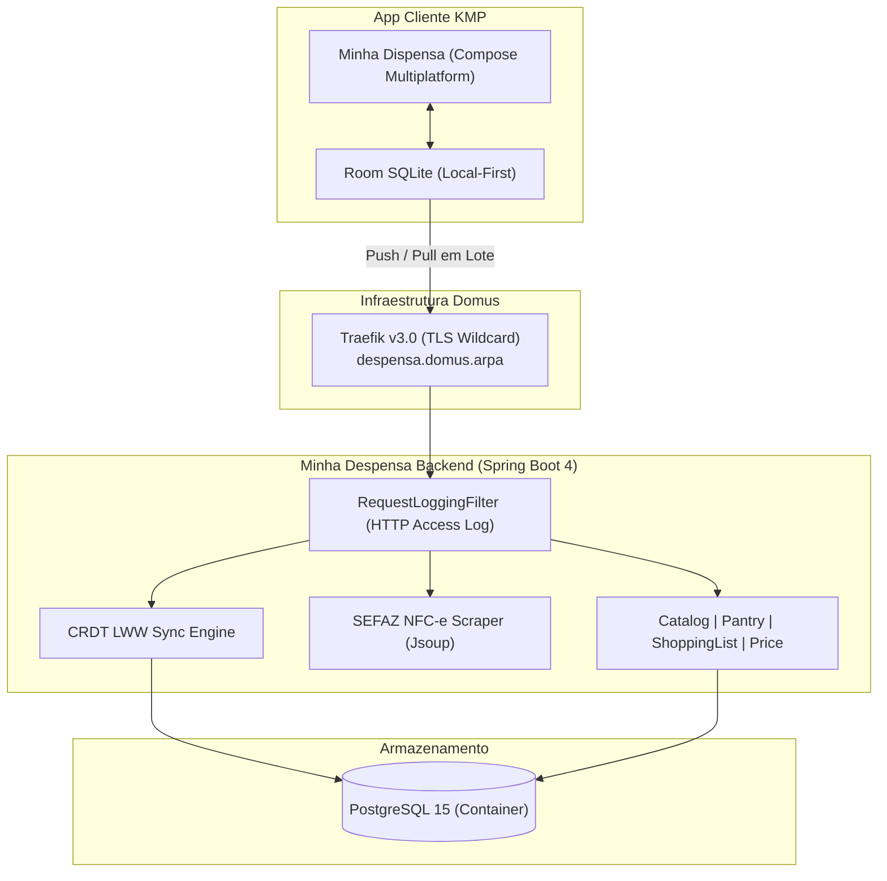

# Pull Request: Release v1.0.0 — Platform Core, Modular Monolith, CRDT Sync, SEFAZ NFC-e & CI/CD Governance

**Branch de Origem:** `dev`  
**Branch de Destino:** `main`  
**Tipo de Mudança:** `feat` / `release`  
**Status dos Testes:** ✅ 100% Verdes (38 testes aprovados)  
**Ambiente Ativo:** `https://despensa.domus.arpa`  

---

## 🎯 1. Resumo Executivo

Este Pull Request consolida o lançamento da **versão 1.0.0** do **Minha Despensa Backend**, estabelecendo a base autoritativa de dados, o hub de sincronização **Local-First** e os serviços externos integrados para o ecossistema móvel Minha Despensa.

O projeto foi concebido sob os princípios de **Clean Architecture**, **Domain-Driven Design (DDD)** e **Modular Monolith** em Kotlin 2.3.21 e Spring Boot 4.1.1, contando com pipeline completo de testes automatizados, governança open source, observabilidade em tempo real e automação de CI/CD.



---

## 🚀 2. Principais Módulos & Entregas

### 🅰️ Módulo de Notas Fiscais SEFAZ-PE (`modules/invoice`)
- **Scraping e Extração Resiliente:** Parser baseado em Jsoup e Regex para processamento de URLs da Nota Fiscal de Consumidor Eletrônica (NFC-e) da SEFAZ Pernambuco lidas via QR Code.
- **Extração Completa:** Recupera Chave de Acesso (44 dígitos), Razão Social / Nome Fantasia do estabelecimento, data/hora de emissão e itens comprados (EAN/GTIN, descrição do produto, unidade de medida, quantidade e preço unitário/total em centavos).
- **Endpoint REST:** `POST /api/v1/invoice/parse` com documentação interativa OpenAPI/Swagger.

### 🅱️ Motor de Sincronização CRDT Last-Write-Wins (`modules/sync`)
- **Arquitetura Local-First:** Desenvolvido para atuar com o cliente móvel sem bloqueios de rede no supermercado.
- **Push em Lote (`POST /api/v1/sync/push`):** Recebe alterações locais e aplica a semântica Last-Write-Wins (LWW) baseada em carimbos de data/hora UTC (`updatedAt`), descartando alterações mais antigas que o estado do servidor.
- **Pull Incremental (`GET /api/v1/sync/pull?since={ts}`):** Devolve deltas de alteração ocorridos desde o último sincronismo com ponteiro `serverTimestamp`.
- **Soft Delete Nativo:** Entidades sincronizáveis estendem `BaseSyncEntity` (`isDeleted = true`) para propagação uniforme de deleções sem órfãos físicos no PostgreSQL.

### 🅲 Catálogo Mestre de Produtos (`modules/catalog`)
- **Manutenção de Produtos:** Endpoints `/api/v1/produtos` e `/api/v1/products` para consulta e cadastro de itens de mercado.
- **Consultas Rápidas:** Busca por código de barras EAN-8/13/14 (`/api/v1/products/ean/{ean}`) e busca textual por nome, marca ou categoria.
- **Correção Crítica Jackson 3:** Anotações de construtor primário padronizadas sem `@field:` para compatibilidade estrita com deserializadores do Kotlin no Jackson 3.

### 🅳 Despensa Doméstica & Ocorrências de Estoque (`modules/pantry`)
- **Distinção Conceitual:** Separação estrita entre o produto mestre e as instâncias físicas de compra (lotes).
- **Agregação em Tempo Real:** Endpoint `/api/v1/despensa` retornando o resumo consolidado de quantidades ativas e ocorrências por lote de validade.
- **Operações de Consumo:** Baixa de estoque controlada e descarte de itens vencidos (`PATCH /api/v1/despensa/itens/{id}/consumir`).

### 🅴 Listas de Compras & Histórico de Preços (`modules/shoppinglist` & `modules/price`)
- **Listas Dinâmicas:** Suporte a listas planejadas (`PLANNED`) e rascunhos rápidos (`SCRATCHPAD`).
- **Cascade Soft-Delete:** Exclusão de listas propaga a remoção lógica atômica de todos os itens associados.
- **Histórico Financeiro:** Gravação do preço histórico por estabelecimento comercial.

---

## 🛡️ 3. Observabilidade & Estratégia de Logs

- **`RequestLoggingFilter`:** Filtro servlet que audita automaticamente 100% das requisições sob `/api/**` no canal `com.bitlabbr.minhadespensa.http.AccessLog`:
  ```text
  2026-10-18T22:10:20.640Z INFO [http-nio-8080-exec-1] c.b.minhadespensa.http.AccessLog : [HTTP] GET /api/v1/test/hello - Status: 200 (76ms) - Client: 100.66.150.125
  ```
- **Auditoria de Erros 4xx:** `GlobalExceptionHandler` configurado para registrar logs de nível `WARN` para requisições inválidas, validações de campos e recursos inexistentes, facilitando diagnósticos remotos instantâneos.
- **Formatação de Console:** Console padronizado com timestamp UTC, thread, nível em destaque e nome do logger.

---

## 🏛️ 4. Governança, Licenciamento & CI/CD

- **`LICENSE`:** Licença padronizada **Creative Commons Attribution-NonCommercial 4.0 International (CC BY-NC 4.0)**, reservando todos os direitos comerciais com Willian Santos.
- **`CONTRIBUTING.md`:** Guia do contribuidor contendo o Contributor License Agreement (CLA), arquitetura do projeto e política inegociável de 100% de testes verdes.
- **Cabeçalhos de Licença:** Todos os 55 arquivos de código-fonte (`.kt`) em `src/main` e `src/test` contêm o cabeçalho oficial de copyright e licença CC BY-NC 4.0.
- **GitHub Actions CI (`.github/workflows/ci.yml`):**
  - Validação automatizada em pushes e PRs para `main`, `dev` e `epic/**`.
  - Compilação Java 17 Temurin + Gradle Cache.
  - Execução de testes unitários com publicação de relatório JUnit.
  - Empacotamento de fat JAR e validação do build da imagem Docker.
- **GitHub Pages (`.github/workflows/pages.yml`):**
  - Publicação contínua da documentação técnica e arquitetural em HTML moderno com Mermaid.js.

---

## 🧪 5. Matriz de Testes & Validação em Produção

| Categoria de Teste | Quantidade | Status |
| :--- | :---: | :---: |
| **Catalog Domain (Service & WebMvc)** | 8 | ✅ Passou |
| **Pantry Domain (Service & WebMvc)** | 10 | ✅ Passou |
| **Shopping List Domain (Service)** | 3 | ✅ Passou |
| **Sync Engine (Service & WebMvc)** | 7 | ✅ Passou |
| **Invoice SEFAZ-PE (Service & Controller)** | 6 | ✅ Passou |
| **Application Bootstrap & Smoke Tests** | 4 | ✅ Passou |
| **Total da Suíte** | **38** | **100% Aprovado** |

### Validação Remota no Servidor Domus
- Implantação validada no contêiner `despensa_api` conectado ao proxy reverso Traefik v3.0 e banco PostgreSQL 15.
- Diagnóstico de integridade testado:
  ```bash
  curl -s https://despensa.domus.arpa/api/v1/test/hello
  # {"status":"UP","app":"Minha Despensa Backend","message":"Servidor online e rodando no Domus!"}
  ```

---

## 📋 6. Checklist de Merge

- [x] 100% dos testes unitários e de integração aprovados localmente (`./gradlew test`).
- [x] Cabeçalhos de licença CC BY-NC 4.0 presentes em todos os arquivos Kotlin.
- [x] Documentação mestre [`Minha-Despensa-Backend.md`](./Minha-Despensa-Backend.md) atualizada e sincronizada.
- [x] Skill [`minha-despensa-backend-engineer`](file:///Users/willian/.gemini/config/skills/minha-despensa-backend-engineer/SKILL.md) atualizada com as regras de governança e logs.
- [x] Arquivo de licença `LICENSE` e guia `CONTRIBUTING.md` presentes na raiz.
- [x] Workflows de CI e GitHub Pages configurados em `.github/workflows/`.
- [x] Deploy em produção testado e operando com sucesso em `https://despensa.domus.arpa`.
